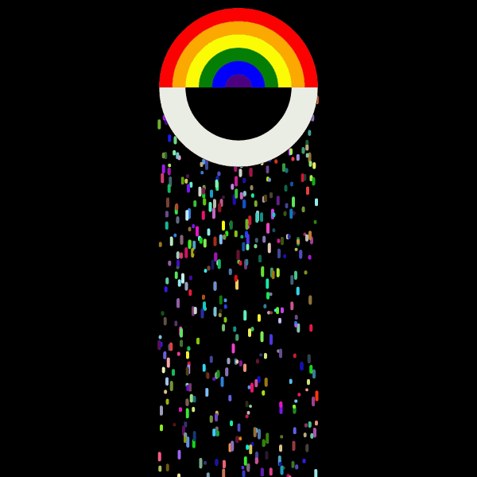

# Wandering-Eyes-Generative-Art

A collection page for **Wandering Eyes** — five works drawn with geometric primitives in p5.js, presented as a collection with a works grid, surfaces, process, and commission sections.

**Live:** `https://reyrove.github.io/Wandering-Eyes-Generative-Art/`

---

## Overview

**Wandering Eyes** is a collection of five works, each drawn with a small vocabulary of geometric primitives — **circles, rectangles, triangles, quads, arcs, and lines** — and accompanied by a written story. The works range from illustrative (a crow beside a human, a vitamin wall column, a dance studio) to interior landscapes (a figure beneath a perpetual black sky, an eye that sees the world).

The collection is held together by the eye — the sense of sight, the act of looking, the wandering gaze. Some works literally contain eyes; others are about the act of seeing. The title comes from the sense that these are not drawings of objects, but of what the eye notices as it moves across a scene.

The page functions as a **collection and licensing surface** for fashion houses, textile studios, and surface designers. All five works are available to license individually or as a set.

---

## What Makes This Collection Different

**Wandering Eyes** sits alongside the artist's other collections (Polar Memories, Fibonacci's Spin, Skyline, Portrait, Girih, and others) but has a distinct character:

| Collection | Format | Character |
|-----------|--------|-----------|
| **Polar Memories** | Six mixed works | p5.Polar geometry, stills + GIFs |
| **Fibonacci's Spin** | Two fixed editions | Fibonacci orbit, animated GIFs |
| **Wandering Eyes** | Five mixed works | Geometric narrative, story-led |

Where **Polar Memories** explores a single library (p5.Polar) and **Fibonacci's Spin** explores a single motion (Fibonacci orbit), **Wandering Eyes** explores a single **narrative gesture** — the wandering gaze — using the simplest possible geometric vocabulary. Each work is a small fable told in shapes.

---

## The Five Works

### 01 / Crow & Human — still

> In a world of lovely hues, the artist's eyes wandered through a canvas of circles, rectangles, and triangles, weaving a code of art that posed a curious question. Amidst this vibrant realm, a crow and a human roved, creating an arc of escape, where pink blended with colours, forming a captivating tapestry in this whimsical and enchanting world.

**Primitives:** Circles · Rectangles · Triangles · **Palette:** Pink / Multicolour · **Format:** JPG

### 02 / Rove Column — still

> If only walls could provide vitamins! Imagine waking up to a nutritious wall column, delivering a daily dose of vitamin art, positivity, and aesthetic wellness — making your living space not just visually appealing but also nutritionally enriching!

**Primitives:** Circles · Triangles · Quads · Lines · **Palette:** Vitamin colour · **Format:** JPG

### 03 / Dance Studio — still

> In a vibrant dance studio, eyes sparkled with anticipation as colourful shoes embraced the floor, their rhythmic movements creating a lively escape. The music guided their wandering steps, forming shapes and lines that wove a tapestry of triangles, rectangles, and circles, transcending the boundaries of a simple square.

**Primitives:** Triangles · Rectangles · Circles · **Palette:** Vivid colour · **Format:** JPG

### 04 / Beyond the tears — animated

> Once, in a world cloaked beneath a perpetual black sky, there lived a solitary figure known as Anika. With one eye reflecting the weight of accumulated sorrows, Anika navigated a landscape obscured by shadows. Tears, like raindrops, fell silently, leaving a trail of melancholy in her wake. In the midst of Anika's desolation, a mysterious event unfolded. A radiant rainbow materialised, defying the eternal darkness...

**Primitives:** Arcs · Rain particles · **Palette:** Rainbow on black · **Format:** GIF

### 05 / The eye of the world — still

> The eye of the world sees everything and nothing. It watches the rise and fall of empires, the birth and death of stars. In its gaze, all things are connected — the ant and the mountain, the whisper and the thunder, the beginning and the end. It is the witness of all things, the silent observer of the infinite dance of existence.

**Primitives:** Arcs · Circles · Lines · **Palette:** Cosmic · **Format:** JPG

Each work carries a written story. The openings above are the first few sentences of each; the full prose lives on the individual work pages.

---

## Features of the Collection Page

### Hero

A single square canvas displaying **Beyond the tears** — the animated work and the collection's most emotionally layered composition.

### Works Grid

A 2-column grid showing all five works, each as a card with:

- A live preview (JPG or GIF) loaded from `/images/`
- The work title in Cormorant Garamond
- The story opening in DM Mono
- Four metadata rows: primitives, palette, medium, format

### Surfaces Section

Three of the five works — **Crow & Human**, **Beyond the tears**, and **The eye of the world** — are shown across four surfaces each:

- **Print** (1:1) — `background-size: contain`
- **Scarf** (3:1) — three repeats horizontally
- **Textile** (4:3) — 2×2 tile
- **Wall** (2:3) — two repeats vertically

The GIFs and JPGs are reused via CSS `background-image`, so the browser caches each file once and serves it to all tiles.

### Process Section

Three cards on the shared logic:

- **Geometric Vocabulary** — the small set of primitives
- **Each Work Has One** — the story-led approach
- **Wandering Gaze** — the eye motif that holds the collection together

### Commission Section

Collection-level licensing:

- **Collection licence** — all five works together
- **Commission a work** — a new composition in the same vocabulary
- **Systems** — a private Wandering Eyes tool for your studio

### Colophon

Standard footer with collection nav, works list, and studio contact.

---

## File Structure

```
Wandering-Eyes-Generative-Art/
├── index.html                        # Single-file collection page
├── README.md
└── images/
    ├── fav.svg                       # Favicon
    ├── crow-human.jpg                # Work 01 — still
    ├── rove-column.jpg               # Work 02 — still
    ├── dance-studio.jpg              # Work 03 — still
    ├── beyond-the-tears.gif          # Work 04 — animated
    ├── th-eye-of-the-world.jpg       # Work 05 — still
    ├── tote.png                      # Mockup — tote bag
    ├── tee.png                       # Mockup — t-shirt
    └── cushion.png                   # Mockup — cushion
```

No build step. No dependencies. No JavaScript animation. The browser handles GIF playback and JPG display natively.

---

## Getting Started

1. Clone the repo:
   ```bash
   git clone https://github.com/reyrove/Wandering-Eyes-Generative-Art.git
   cd Wandering-Eyes-Generative-Art
   ```
2. Drop the five image files into `images/` with the exact names above.
3. Add the three mockup PNGs (optional — they appear in the Commission section).
4. Open `index.html` in a browser.

That's it. The page loads all five works and presents them in the collection layout.

---

## How the Page Is Organised

| Section | ID | Purpose |
|---------|-----|---------|
| Cover | — | Hero title + Beyond the tears GIF |
| Statement | `#statement` | Artist statement about the collection |
| Works | `#works` | Five work cards with story openings and metadata |
| Surfaces | `#surfaces` | Three works × four surfaces = 12 tiles |
| Process | `#process` | Three process cards on the shared logic |
| Commission | `#commission` | Collection licensing + mockups + CTA |
| Colophon | — | Footer, works list, studio links, legal modal |
| Legal modal | `#legalModal` | Licensing / Terms / Credits |

---

## Customisation

### Change the cover work

The cover currently shows **Beyond the tears**. To feature a different work, edit the `src` in the cover ``:

```html
<div class="cover-art">
  
</div>
```

### Change the surfaces shown

The surfaces section shows three of the five works. To show all five, copy the `<div class="surface-work-head">` + `<div class="surface-grid">` block for each work and update the `background-image` URLs.

### Change the works grid layout

The works grid uses CSS grid with `grid-template-columns: 1fr 1fr`. Change to `1fr` for a single column or `1fr 1fr 1fr` for a three-column layout on wider screens.

### Replace the mockups

Swap the three PNGs in `images/` or update the `src` attributes in the Commission section.

### Add a sixth work

Add a new `<article class="work-card">` block to the works grid and a corresponding surfaces block. Update the collection counts in the cover meta, statement, and colophon.

### Change the story openings

Each work card carries the opening two to three sentences of the story. Edit the `.work-card-desc` text. The full stories live on the individual work pages.

### Rename the fifth work file

If the file is actually `eye-of-the-world.jpg` (without the `th-` prefix), search-and-replace `th-eye-of-the-world` with `eye-of-the-world` in the HTML.

---

## Individual Work Pages

Each work in the collection can have its own repository, following the same pattern used by **Polar Memories** and **Fibonacci's Spin**. Suggested names:

| Work | Suggested repo |
|------|---------------|
| Crow & Human | `Wandering-Eyes-Crow-and-Human` |
| Rove Column | `Wandering-Eyes-Rove-Column` |
| Dance Studio | `Wandering-Eyes-Dance-Studio` |
| Beyond the tears | `Wandering-Eyes-Beyond-the-Tears` |
| The eye of the world | `Wandering-Eyes-Eye-of-the-World` |

Each work page would follow the same editorial template with a single-work hero, its own statement, surfaces, process, and commission section.

If you create these repos, the collection page's colophon "Works" column can be updated from `#` placeholders to real links.

---

## Design System

| Token | Value | Use |
|-------|-------|-----|
| `--bg` | `#0a0a0a` | Page background |
| `--bg-soft` | `#0f0f0e` | Statement / Commission background |
| `--paper` | `#f4f1ea` | Light surface (Surfaces section) |
| `--gold` | `#b8935a` | Primary accent |
| `--gold-soft` | `#d4b483` | Italic emphasis |
| `--serif` | Cormorant Garamond | Headings, titles |
| `--mono` | DM Mono | Labels, metadata, UI |

Type scale, spacing, and section rhythm match the artist's other collections. Responsive breakpoints at 900px, 720px, 560px, and 400px.

---

## Keyboard Shortcuts

| Key | Action |
|-----|--------|
| `Enter` / `Space` | Activate focused link or button |
| `Esc` | Close legal modal |

---

## Browser Support

Modern evergreen browsers with:

- Animated GIF support (universal)
- CSS custom properties (universal)
- `backdrop-filter` (Safari 9+, Chrome 76+, Firefox 103+)
- `aspect-ratio` CSS property (universal in modern browsers)

Fallback: the page works in any browser that can render an `` tag with a GIF or JPG.

---

## Accessibility

- All images have descriptive `alt` text
- Legal modal traps focus, closes on `Esc` and overlay click
- `prefers-reduced-motion` disables all transitions
- All interactive elements have visible focus states (via browser default)
- Ribbon nav scrolls horizontally on mobile with a gradient mask

---

## Deployment (GitHub Pages)

1. Push the repo to GitHub.
2. Go to **Settings → Pages**.
3. Under **Source**, select `Deploy from a branch`.
4. Choose branch `main` and folder `/ (root)`.
5. Save — the site goes live at `https://reyrove.github.io/Wandering-Eyes-Generative-Art/`.

---

## Notes on the Source

This page does not use p5.js. The five works were originally drawn as p5.js sketches using geometric primitives; the outputs were captured as JPGs (for the stills) and a GIF (for the animated work), and are presented here as images.

**Why images rather than live sketches:**

- Images are lighter than continuous canvas redraws — the browser handles playback natively.
- The image files are cached after first load, so the 12 surface tiles reuse just three files.
- The page has no external dependency beyond Google Fonts.

**One trade-off:** the GIF's frame rate is locked into the file. The original sketch may have run at a different rate than the GIF's encoded rate.

---

## Related Repositories

| Repo | Theme |
|------|-------|
| [`Skyline-Series`](https://github.com/reyrove/Skyline-Series) | Themed cityscapes |
| [`Portrait-Series-Generative-Art`](https://github.com/reyrove/Portrait-Series-Generative-Art) | Generative faces |
| [`Girih-2-Generative-Art`](https://github.com/reyrove/Girih-2-Generative-Art) | Islamic geometric ornament |
| [`Gothic-Grid-Generative-Art`](https://github.com/reyrove/Gothic-Grid-Generative-Art) | Mosaic grid composition |
| [`Order-to-Chaos-Generative-Art`](https://github.com/reyrove/Order-to-Chaos-Generative-Art) | Gradient grid composition |
| [`Wallpaper-Groups-Generative-Art`](https://github.com/reyrove/Wallpaper-Groups-Generative-Art) | Crystallographic symmetry |
| [`Wandering-Tiles-Generative-Art`](https://github.com/reyrove/Wandering-Tiles-Generative-Art) | Line-drawing composition |
| [`Food-Grid-Generative-Art`](https://github.com/reyrove/Food-Grid-Generative-Art) | Illustrated food grid |
| [`Framed-Line-Generative-Art`](https://github.com/reyrove/Framed-Line-Generative-Art) | Gesture line composition |
| [`Deconstructed-Stage-Generative-Art`](https://github.com/reyrove/Deconstructed-Stage-Generative-Art) | Suprematist composition |
| [`Layered-Diagram-Generative-Art`](https://github.com/reyrove/Layered-Diagram-Generative-Art) | Layered linework composition |
| [`Japanese-Patterns-Generative-Art`](https://github.com/reyrove/Japanese-Patterns-Generative-Art) | Traditional motif composition |
| [`Matrix-Rain-Generative-Art`](https://github.com/reyrove/Matrix-Rain-Generative-Art) | Digital rain composition |
| [`Organic-Shapes-Generative-Art`](https://github.com/reyrove/Organic-Shapes-Generative-Art) | Layered petal-form composition |
| [`Recursive-Grid-Generative-Art`](https://github.com/reyrove/Recursive-Grid-Generative-Art) | Recursive subdivision composition |
| [`Generative-Lifeform-Generative-Art`](https://github.com/reyrove/Generative-Lifeform-Generative-Art) | Network / node-graph composition |
| [`Game-of-Seeds-Generative-Art`](https://github.com/reyrove/Game-of-Seeds-Generative-Art) | Cellular automaton composition |
| [`Fibonacci-Spin-Generative-Art`](https://github.com/reyrove/Fibonacci-Spin-Generative-Art) | Fibonacci orbit collection |
| [`Polar-Memories-Generative-Art`](https://github.com/reyrove/Polar-Memories-Generative-Art) | p5.Polar collection |
| **`Wandering-Eyes-Generative-Art`** | Geometric narrative collection *(this repo)* |

All nineteen share the same catalogue template, design tokens, and editorial register.

---

## Credits

- **Design & Code** — Reyhaneh Daneshdoost
- **Typefaces** — Cormorant Garamond, DM Mono
- **Engine** — p5.js · Generative geometry
- **Collection** — Wandering Eyes, Autumn 2026
- **Works** — Crow & Human · Rove Column · Dance Studio · Beyond the tears · The eye of the world

---

## License

All artwork, code, and motion systems are the intellectual property of the artist. Works may not be reproduced, redistributed, resold, or adapted without a written licence.

For licensing, commissions, or private systems: **reyhanehdaneshdoost@gmail.com**